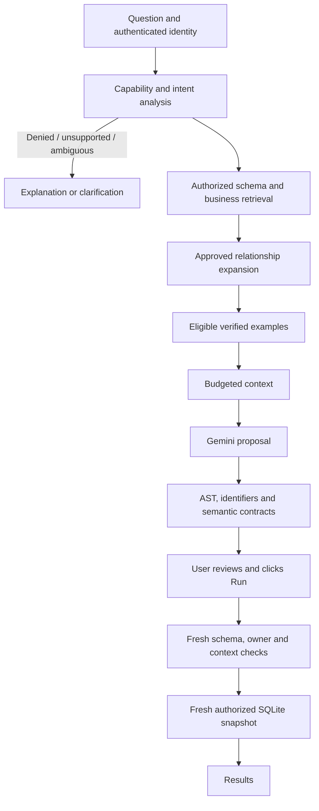

# 12/11/2026 — Detailed implementation log

Date: 12 November 2026 (Asia/Calcutta). Implementation branch: `codex/schema-intelligence`.
Application implementation commit: `8354a8c` (`Add schema intelligence retrieval and semantic SQL validation`).

## 1. What was requested and delivered

The original request was an audit and plan for schema intelligence, business-context retrieval,
BM25 relationship expansion and verified SQL examples. The subsequent instruction authorized
implementation and explicitly added semantic validation. This log records the resulting code,
not hypothetical future functionality. The dated log and remaining README edit are a follow-up
documentation change after the implementation commit.

Delivered features:

1. Automatic SQLAlchemy metadata extraction from explicitly allowed physical sources.
2. A permission-aware logical schema matching the existing SQLite execution surface.
3. Reviewed, versioned business definitions and synonyms stored separately from discovery.
4. Bounded intent analysis with query, clarification, unsupported and denied outcomes.
5. BM25Plus retrieval over schema and business documents, with a separate example channel.
6. Approved relationship graph expansion, bridge tables and composite-key handling.
7. Reviewed SQL demonstrations with evidence, permissions and dependency compatibility checks.
8. Explicit local example approval using independent fixture expectations and a review note.
9. Budgeted context assembly and structured Gemini prompting.
10. SQLite-specific AST and schema/alias validation.
11. Deterministic semantic checks for supported metrics, filters, grain and rankings.
12. Owner/context-version binding and fresh checks before approved execution.
13. UI explanations for unsupported requests and visible context/validation evidence.
14. Bounded snapshot reads and preserved employee primary keys inside SQLite.
15. Provider error classification and actual usage-metadata capture when available.
16. A 56-case evaluation dataset, A/B/C/D context ablations and an explicit live-model mode.
17. Regression, security, retrieval, semantic, fixture and UI tests plus GitHub Actions CI.
18. Updated dependency declarations and current implementation documentation.

## 2. Architecture before and after

Previously, the application built a fixed schema string from permitted column names, made one
Gemini request, checked the SQL root statement type, displayed a proposal and executed it only
after the user clicked Run. Existing backend RBAC restricted the source rows/columns before
creating a private in-memory SQLite snapshot.

The upgrade preserves that boundary. MySQL remains the source, PyMySQL remains its driver,
SQLAlchemy remains the database toolkit, Gemini remains the provider, and Streamlit remains
the UI. It adds retrieval and deterministic validation around the existing proposal workflow.
No vector database, microservice, autonomous SQL execution loop or provider migration was added.



The physical `RBAC_DEMO_EMPLOYEES` table is exposed as logical `EMPLOYEES`. The original
physical `EMPLOYEES` and `RBAC_DEMO_AUDIT` are not automatically exposed to generated SQL.
The current logical catalog has no declared foreign keys. Positive relationship expansion
and multi-table fanout checks are demonstrated by synthetic tests, not newly enabled live tables.

## 3. Evidence and verification recorded during implementation

| Check | Observed result |
|---|---|
| Original suite before the upgrade | 61 tests passed |
| Final implementation suite | 141 tests passed in 14.69 seconds |
| Offline evaluation | 56/56 cases passed in each A/B/C/D configuration |
| Held-out/development split | 51 held-out, five development cases |
| Live metadata retrieval | Passed; employee context exposed only the logical employee table and no salary field |
| Live restricted snapshot read | Passed; employee account counted three authorized rows |
| Real Gemini smoke request | Blocked by `GooglePermissionDeniedError` |
| Application deployment | No merge or deployment performed |
| First GitHub push attempt | Authentication required; upload was not confirmed at that point |

Offline passes establish fixture/oracle and contract behavior. They are not LLM accuracy,
token-saving or business-correctness benchmark gains. The real-provider failure prevents a
claim that live Gemini generation completed successfully. Credentials were not changed or
printed. The provider wrapper now gives an actionable access error without showing its body.

The broken ignored virtual-environment launcher referenced an unavailable Anaconda interpreter.
It was repaired using the installed Python 3.12 interpreter while preserving existing packages.
`rank-bm25==0.2.2` was installed and pinned. No live schema migration or destructive SQL was run.

## 4. Code-level implementation explanations and exact excerpts

The excerpts below are extracted from the implementation files at documentation time. Some
functions are shown partially, explicitly marked as excerpts. They are explanatory copies;
the Python files remain the executable source of truth.

### 4.1. Automatic schema discovery

Source: `schema_context.py` → `extract_catalog()`.

Uses SQLAlchemy Inspector for columns, physical types, nullability, primary keys, unique constraints, supported comments and FKs within the allowlist. SQL affinities are normalized for the logical SQLite surface. Unique child keys distinguish one-to-one from many-to-one relationships.

```python
def extract_catalog(engine, allowed_sources: set[str]) -> SchemaCatalog:
    """Inspect only configured sources; discovering a table does not grant access."""
    inspector = inspect(engine)
    tables, relationships = [], []
    for name in sorted(allowed_sources):
        if not _IDENTIFIER.fullmatch(name) or not inspector.has_table(name):
            raise CatalogError("An approved source table is unavailable.")
        columns = []
        for column in inspector.get_columns(name):
            if not _IDENTIFIER.fullmatch(column["name"]):
                raise CatalogError("An approved source contains an unsupported identifier.")
            source_type = str(column["type"])
            affinity = getattr(column["type"], "_type_affinity", type(column["type"])).__name__.lower()
            if "int" in affinity:
                logical_type = "INTEGER"
            elif any(word in affinity for word in ("numeric", "float", "real")):
                logical_type = "REAL"
            elif "binary" in affinity:
# ... remaining function omitted in this excerpt ...
```

### 4.2. Authorized logical projection

Source: `schema_context.py` → `project_catalog()`.

Checks the caller, required fields, employee identity key and expected types. visible_columns(user) filters metadata before retrieval. Source discovery never grants query access. Manager names remain labels, not approved join keys.

```python
def project_catalog(catalog: SchemaCatalog, user) -> SchemaCatalog:
    require(user, "query")
    source = next((table for table in catalog.tables if table.name == SOURCE_TABLE), None)
    if source is None:
        raise CatalogError("The approved employee source is unavailable.")
    names = visible_columns(user)
    available = {column.name: column for column in source.columns}
    if not set(names).issubset(available):
        raise CatalogError("The employee schema changed. Refresh the approved mapping before querying.")
    if source.primary_key != ("EMPLOYEE_ID",):
        raise CatalogError("The employee identity key changed. Review the snapshot grain before querying.")
    # These are the types used by the existing snapshot, now verified against reflection.
    for name in names:
        expected = "INTEGER" if name in {"EMPLOYEE_ID", "SALARY"} else "TEXT"
        if available[name].data_type != expected:
            raise CatalogError("An employee column changed type. Review the snapshot mapping.")
    table = TableRecord("EMPLOYEES", tuple(available[name] for name in names),
                        tuple(c for c in source.primary_key if c in names), SOURCE_TABLE,
                        "One row per authorized employee. Manager name is a label, not a unique join key.")
    # No other physical source or candidate relationship is exposed by this mapping.
    return SchemaCatalog((table,), scope=scope_description(user))
```

### 4.3. Metadata cache and fresh execution checks

Source: `schema_context.py` → `get_catalog()`.

Physical reflection uses a five-minute, 16-entry cache. A credential-derived hash is an internal identity key; raw URIs are not displayed. Refresh and in-memory fixtures bypass this cache. Execution calls refresh=True.

```python
def get_catalog(user, engine, *, refresh: bool = False) -> SchemaCatalog:
    require(user, "query")
    if refresh or engine.url.database in {None, "", ":memory:"}:
        physical = extract_catalog(engine, {SOURCE_TABLE})
    else:
        # Identity only; the URI is never emitted or used as a human-readable cache key.
        identity = engine.url.render_as_string(hide_password=False)
        source_key = hashlib.sha256(identity.encode()).hexdigest()
        physical = _cached_extract(source_key, engine)
    return project_catalog(physical, user)
```

### 4.4. Business definitions and permissions

Source: `business_context.py` → `load_business_rules()`.

Loads reviewed YAML separately from discovered structure. Non-approved and unauthorized definitions are removed before indexing. Approved field references, metric specifications and filter expressions are checked for consistency.

```python
def load_business_rules(catalog, user, path=RULES_PATH) -> tuple[BusinessRule, ...]:
    require(user, "query")
    schema, result = catalog.sqlglot_schema(), []
    for record in _parse_rules(Path(path).read_text(encoding="utf-8")):
        if record.get("status") != "approved":
            continue
        permission = record.get("permission", "")
        if permission and not allowed(user, permission):
            continue
        for reference in record["columns"]:
            table, column = reference.split(".", 1)
            if column not in schema.get(table, {}):
                raise ValueError("An approved business definition references an unavailable field.")
        if record["kind"] == "metric":
            field = record.get("field")
            if (record.get("aggregate") not in {"COUNT", "SUM", "AVG", "MIN", "MAX"}
                or not isinstance(field, str) or not field
                or (field == "*" and record["aggregate"] != "COUNT")
                or (field != "*" and not any(reference.endswith("." + field) for reference in record["columns"]))):
                raise ValueError("Unsupported approved metric definition.")
        predicates = record.get("predicates", [])
        if not isinstance(predicates, list) or not all(isinstance(predicate, str) for predicate in predicates):
            raise ValueError("Business-rule predicates must be SQL expression strings.")
        for predicate in predicates:
# ... remaining function omitted in this excerpt ...
```

### 4.5. Intent analysis

Source: `business_context.py` → `analyze_intent()`.

Returns a structured Intent. Recognized patterns identify metrics, grouping, literal filters, requested employee fields, numeric thresholds, HAVING constraints and top/bottom ranking. Unsupported revenue/history/date requests and prohibited salary access stop before the model. This is bounded pattern recognition, not general language understanding.

```python
def analyze_intent(question: str, catalog, rules, user) -> Intent:
    """Recognize supported contracts; this is not a general natural-language parser."""
    require(user, "query")
    if not isinstance(question, str) or not question.strip() or len(question) > 4000:
        return Intent("clarification", "Enter a question of 1–4,000 characters.")
    q = question.lower().strip()
    if re.search(r"\b(salar(?:y|ies)|payroll|compensation|wages?|pay)\b", q) and not allowed(user, "salary"):
        return Intent("denied", "Your role cannot query salary information.")
    if re.search(r"\b(delete|drop|truncate|insert|update|alter|create)\b", q):
        return Intent("unsupported", "The SQL assistant supports read-only analytics. Use the approved admin screen for job-title edits.")
    if re.search(r"other database tables|sqlite_master|information_schema|ignore.+schema", q):
        return Intent("denied", "Only the authorized logical employee table is available.")
    unsupported = r"\b(customers?|orders?|revenue|refunds?|cancelled|hired?|hiring|joined|tenure|audit|history|growth|active employees|employment|title changes)\b|\b(last|this|previous)\s+(month|year|quarter|week)\b|\bas of\b|\bmonthly\b"
    if re.search(unsupported, q):
        return Intent("unsupported", "The authorized employee snapshot has no customer, order, historical, employment-date, or activity data for this request.")
    if re.search(r"\b(join|manager.s manager|manager.s salary|manager.s department|reporting chain|manager(?: employee)? id)\b", q):
        return Intent("unsupported", "No approved identity-based join or reporting-chain relationship is available. Recorded manager names are labels only.")
    if re.search(r"\b(best employee|manager performance|payroll|jane.s team)\b", q) or q in {"show managers", "list managers"}:
        return Intent("clarification", "Specify the metric and population. Salary values have no defined currency or pay period; manager labels do not establish manager identities.")
    selected = [rule for rule in rules if any(phrase_matches(alias, q) for alias in rule.aliases)]
    metrics = [rule for rule in selected if rule.kind == "metric"]
    if re.search(r"\btop\s+(?:\d+|one|two|three|four|five|ten)\b", q) and not re.search(r"\bdepartments?\b", q):
        metrics = [rule for rule in metrics if rule.aggregate != "MAX"]
# ... remaining function omitted in this excerpt ...
```

### 4.6. BM25 retrieval and lexical overlap

Source: `retrieval.py` → `BM25Index.search()`.

Documents are already permission-filtered. BM25Plus supplies ranking scores; an explicit token-overlap gate prevents smoothing scores from admitting unrelated documents. Empty and tiny collections are handled. Ties use stable document IDs.

```python
    def search(self, question: str, k: int = 5) -> tuple[SearchHit, ...]:
        query = tokenize(question)
        if not self.model or not query or k <= 0:
            return ()
        scores = self.model.get_scores(query)
        # BM25Plus has a smoothing baseline: nonzero scores do not prove lexical overlap.
        eligible = [i for i, tokens in enumerate(self.tokens) if set(query).intersection(tokens)]
        ranked = sorted(eligible, key=lambda i: (-float(scores[i]), self.documents[i].id))[:k]
        return tuple(SearchHit(self.documents[i], float(scores[i])) for i in ranked)
```

### 4.7. Relationship graph expansion

Source: `retrieval.py` → `expand_relationships()`.

Builds adjacency lists only from approved edges whose endpoints and key columns remain visible. Bounded breadth-first search adds intermediate bridge tables. Missing, ambiguous and over-budget paths fail. Current live mapping has no edges; tests exercise composite keys and bridges.

```python
def expand_relationships(selected_tables: set[str], catalog, *, max_hops: int = 2):
    """Connect selected endpoints using unique bounded approved paths. Never invent edges."""
    available = {table.name: {column.name for column in table.columns} for table in catalog.tables}
    if not selected_tables.issubset(available):
        raise ValueError("A selected table is outside the authorized catalog.")
    edges = []
    for relationship in catalog.relationships:
        if not relationship.approved:
            continue
        if not relationship.from_columns or len(relationship.from_columns) != len(relationship.to_columns):
            raise ValueError("Invalid composite relationship.")
        if (relationship.from_table in available and relationship.to_table in available
            and set(relationship.from_columns).issubset(available[relationship.from_table])
            and set(relationship.to_columns).issubset(available[relationship.to_table])):
            edges.append(relationship)
    graph = {name: [] for name in available}
    for edge in edges:
        graph[edge.from_table].append((edge.to_table, edge))
        graph[edge.to_table].append((edge.from_table, edge))
    chosen, connected = {}, set()
    targets = sorted(selected_tables)
    if targets:
        connected.add(targets[0])
    for target in targets[1:]:
        queue = deque((start, (), frozenset({start})) for start in sorted(connected))
        found, shortest = [], None
# ... remaining function omitted in this excerpt ...
```

### 4.8. Verified-example eligibility

Source: `sql_examples.py` → `eligible_examples()`.

Checks approval evidence, reviewer/date, dialect, permissions, schema-dependency fingerprint and rule versions. Actual SQL dependencies must fit declared metadata. Current schema and semantic validation run again before an example becomes prompt context.

```python
def eligible_examples(records, catalog, rules, user) -> tuple[dict, ...]:
    rule_versions = {rule.id: rule.version for rule in rules}
    result = []
    for record in records:
        if record.get("verification_status") != "approved" or record.get("sql_dialect") != catalog.dialect:
            continue
        if (not isinstance(record.get("template_family"), str) or not record["template_family"]
            or not isinstance(record.get("question"), str) or not 1 <= len(record["question"]) <= 4000
            or not isinstance(record.get("reviewer"), str) or not isinstance(record.get("reviewed_at"), str)):
            continue
        evidence = record.get("verification_evidence", {})
        if (not record.get("reviewer") or not record.get("reviewed_at") or not isinstance(evidence, dict)
            or evidence.get("semantic_review") is not True or evidence.get("expected_result_review") is not True
            or not evidence.get("fixture") or not evidence.get("test")):
            continue
        try:
            if not all(allowed(user, permission) for permission in record["required_permissions"]):
                continue
            if any(rule_versions.get(name) != version for name, version in record["business_rule_versions"].items()):
                continue
            if dependency_version(catalog, record["referenced_tables"], record["referenced_columns"]) != record["schema_version"]:
                continue
            tree = validate_sql_schema(record["sql"], catalog)
            actual_tables, actual_columns = set(), set()
            for scope in traverse_scope(tree):
                for source in scope.sources.values():
                    if isinstance(source, exp.Table):
                        actual_tables.add(source.name.upper())
# ... remaining function omitted in this excerpt ...
```

### 4.9. Explicit example review

Source: `sql_examples.py` → `approve_example()`.

Requires a draft, named reviewer, substantive semantic review note and independently reviewed expected rows. Uses local SQLite, validates the SQL and compares fixture results. Execution success alone cannot approve an example. The public demo admin UI has no approval capability.

```python
def approve_example(record, engine, *, reviewer: str, review_note: str, expected_rows):
    """Explicit maintainer approval against a disposable fixture, never auto-promotion.

    The caller supplies independently reviewed expectations and a semantic review note.
    Matching results supplement that review; execution success alone is insufficient.
    """
    from business_context import load_business_rules
    from database import run_query
    from rbac import USERS
    from schema_context import get_catalog
    from utils import compare_result_rows

    if record.get("verification_status") != "draft":
        raise ValueError("Only a draft example can be approved. Re-review stale examples as new drafts.")
    if not reviewer.strip() or len(review_note.strip()) < 20 or not isinstance(expected_rows, list):
        raise ValueError("Approval requires a reviewer, a semantic review note and independent expected-result rows.")
    if engine.dialect.name != "sqlite":
        raise ValueError("Example approval must use a disposable local SQLite fixture, not the live source.")
    user = USERS["hr"]
    catalog = get_catalog(user, engine, refresh=True)
    rules = load_business_rules(catalog, user)
    intent = analyze_intent(record["question"], catalog, rules, user)
    validate_sql(record["sql"], catalog, intent, rules)
    _, rows = run_query(record["sql"], user, engine)
    if not compare_result_rows(rows, expected_rows, ordered="ORDER BY" in record["sql"].upper()):
        raise ValueError("The query result does not match the independently reviewed fixture expectation.")
    approved = {**record,
        "schema_version": dependency_version(catalog, record["referenced_tables"], record["referenced_columns"]),
# ... remaining function omitted in this excerpt ...
```

### 4.10. Context assembly

Source: `context_pipeline.py` → `prepare_context()`.

Retrieves table and business documents independently, retains mandatory definitions, expands approved relationships and retrieves compatible examples. Full small schemas are kept. Optional demonstrations are dropped before optional rules when the 18,000-character budget is exceeded. Required context is never silently truncated.

```python
def prepare_context(question, user, engine=None, *, catalog=None, mode="D", refresh=False,
                    rules_path=RULES_PATH, examples_path=EXAMPLES_PATH,
                    max_characters=CONTEXT_MAX_CHARACTERS) -> ContextPackage:
    require(user, "query")
    if mode not in {"A", "B", "C", "D"}:
        raise ValueError("Unknown context configuration.")
    catalog = catalog if catalog is not None else get_catalog(user, _engine(engine), refresh=refresh)
    rules = load_business_rules(catalog, user, rules_path)
    intent = analyze_intent(question, catalog, rules, user)
    # Rejected requests never retrieve examples or call an LLM.
    if intent.status != "query":
        return ContextPackage(catalog, (), intent, (), (), fingerprint({"catalog": catalog.version, "rules": rules_version(rules)}), "")
    documents = build_documents(catalog, rules)
    # Independent channels prevent table text from crowding out business definitions.
    expanded_question = question + " " + " ".join(rule.id for rule in rules if rule.id in intent.rule_ids)
    table_hits = cached_index(tuple(d for d in documents if d.kind == "table")).search(expanded_question, 3)
    rule_hits = cached_index(tuple(d for d in documents if d.kind == "rule")).search(expanded_question, 5)
    hits = table_hits + rule_hits if mode in {"C", "D"} else ()
    required_rule_ids = set(intent.rule_ids) | {"employee_grain", "authorized_scope"}
    if any(rule.permission == "salary" and rule.id in required_rule_ids for rule in rules):
        required_rule_ids.add("salary_units")
    selected_rule_ids = required_rule_ids | {hit.document.id.removeprefix("rule:") for hit in rule_hits}
    selected_rules = tuple(rule for rule in rules if mode == "B" or rule.id in selected_rule_ids) if mode != "A" else ()
    # Retain a full small schema. Prune only when multiple table documents exceed the budget.
    selected_tables = {table.name for table in catalog.tables}
    if len(catalog.tables) > 3 and len(catalog.render()) > max_characters // 2 and mode in {"C", "D"}:
        selected_tables = {name for hit in table_hits for name in hit.document.tables}
        selected_tables.update(reference.split(".")[0] for rule in selected_rules for reference in rule.columns)
# ... remaining function omitted in this excerpt ...
```

### 4.11. Proposal generation

Source: `context_pipeline.py` → `prepare_proposal()`.

The single model call is followed by deterministic validation. The proposal stores owner, original question, context fingerprint, selected rules/examples, retrieval scores, context size, usage and preparation duration. No query executes here.

```python
def prepare_proposal(question, user, engine=None, *, mode="D", rules_path=RULES_PATH, examples_path=EXAMPLES_PATH):
    started = time.perf_counter()
    context = prepare_context(question, user, engine, mode=mode, rules_path=rules_path, examples_path=examples_path)
    if context.intent.status != "query":
        return {"status": context.intent.status, "message": context.intent.message}
    # The full catalog's semantic rules are used even when optional prompt context was dropped.
    rules = load_business_rules(context.catalog, user, rules_path)
    generated = sql_generator.generate_sql(question, context.prompt_context)
    if generated.get("status", "proposal") != "proposal":
        return generated
    validation = validate_sql(generated["sql"], context.catalog, context.intent, rules)
    return {**generated, "status": "proposal", "owner": user.username, "question": question,
            "context_version": context.version, "mode": mode,
            "validation": asdict(validation), "context": {
                "tables": [table.name for table in context.catalog.tables],
                "rules": [rule.id for rule in context.rules],
                "examples": [example["id"] for example in context.examples],
                "retrieval": [{"id": hit.document.id, "score": round(hit.score, 4)} for hit in context.hits],
                "characters": len(context.prompt_context),
                "estimated_tokens": (len(context.prompt_context) + 3) // 4,
                "warnings": list(context.warnings)},
            "preparation_seconds": round(time.perf_counter() - started, 4)}
```

### 4.12. Statement safety

Source: `safety.py` → `parse_readonly_sql()`.

Parses SQLite explicitly, enforces a single query and a 20,000-character ceiling, then scans descendants for DML, DDL, output targets and locks. This closes the earlier root-only check that accepted SELECT INTO and a write-containing CTE.

```python
def parse_readonly_sql(sql: str):
    if not isinstance(sql, str) or not sql.strip():
        raise UnsafeQueryError("Empty SQL query.")
    if len(sql) > 20_000:
        raise UnsafeQueryError("SQL exceeds the 20,000-character limit.")
    try:
        statements = sqlglot.parse(sql, read="sqlite")
    except Exception as exc:
        raise UnsafeQueryError("Unable to parse the SQLite query.") from exc

    if len(statements) != 1:
        raise UnsafeQueryError(
            "Multiple SQL statements are not allowed — only one query per request."
        )

    tree = statements[0]
    if tree is None or not isinstance(tree, exp.Query):
        raise UnsafeQueryError(
            "Only read-only queries (SELECT, or a UNION/INTERSECT/EXCEPT of "
            "SELECTs) are allowed. This query was rejected before it ever "
            "reached the database."
        )
    forbidden = (exp.DML, exp.DDL, exp.Into, exp.Lock, exp.Command, exp.Pragma,
                 exp.Attach, exp.Transaction, exp.Grant, exp.Revoke)
    if any(isinstance(node, forbidden) for node in tree.walk()):
        raise UnsafeQueryError("Write operations, output targets and locking are not allowed anywhere in a query.")
    return tree
```

### 4.13. Identifier binding

Source: `safety.py` → `validate_sql_schema()`.

Checks authorized base tables, rejects external table qualification and file/extension functions, and qualifies columns through aliases and CTE scopes using SQLGlot. An existing table name does not make an unknown column valid.

```python
def validate_sql_schema(sql: str, catalog):
    tree = parse_readonly_sql(sql)
    available = {table.name.upper() for table in catalog.tables}
    for node in tree.walk():
        if isinstance(node, exp.Func) and node.sql_name().lower() in {"readfile", "writefile", "load_extension"}:
            raise SchemaValidationError("File and extension functions are unavailable.")
        if isinstance(node, exp.Anonymous) and node.name.lower() in {"readfile", "writefile", "load_extension", "eval"}:
            raise SchemaValidationError("File and extension functions are unavailable.")
    for scope in traverse_scope(tree):
        for source in scope.sources.values():
            if isinstance(source, exp.Table):
                if source.db or source.catalog or not isinstance(source.this, exp.Identifier) or source.name.upper() not in available:
                    raise SchemaValidationError("A table is outside your authorized logical schema.")
            elif not isinstance(source, Scope):
                raise SchemaValidationError("Only authorized tables and query scopes are supported.")
    try:
        return qualify(tree.copy(), dialect=catalog.dialect, schema=catalog.sqlglot_schema(),
                       infer_schema=False, validate_qualify_columns=True)
    except Exception as exc:
        raise SchemaValidationError("A column, alias or query scope does not match your authorized schema.") from exc
```

### 4.14. Metric expressions and CTE lineage

Source: `semantic_validation.py` → `_is_metric()`.

Follows supported projected aliases through CTEs/subqueries. The actual projected aggregate must match the approved function, field and DISTINCT policy. COUNT(*) must derive from the expected employee population. An unused correct inner aggregate cannot validate a wrong outer output.

```python
def _is_metric(expression, scope, rule):
    expression, scope = _resolve(expression, scope)
    # A harmless rounding wrapper is supported. Arbitrary arithmetic is not proof.
    if isinstance(expression, exp.Round):
        expression = expression.this
    if not isinstance(expression, exp.AggFunc) or expression.sql_name() != rule.aggregate:
        return None
    argument = expression.this
    distinct = isinstance(argument, exp.Distinct)
    if distinct:
        argument = argument.expressions[0] if len(argument.expressions) == 1 else None
    if distinct != rule.distinct or expression.args.get("expressions"):
        return None
    if rule.field == "*":
        if not isinstance(argument, exp.Star):
            return None
        tables = _base_tables(scope)
        expected = {reference.split(".")[0] for reference in rule.columns}
        if tables != expected:
            return None
        return scope
    if not isinstance(argument, exp.Column):
        return None
    column, source_scope = _resolve(argument, scope)
    if not isinstance(column, exp.Column) or column.name.upper() != rule.field.upper():
        return None
    source = source_scope.sources.get(column.table)
    expected = {reference.split(".")[0] for reference in rule.columns if reference.endswith("." + rule.field)}
    if not isinstance(source, exp.Table) or source.name.upper() not in expected:
        return None
    return scope
```

### 4.15. Required conjunctive filters

Source: `semantic_validation.py` → `_conjuncts()`.

Only guaranteed top-level AND conjuncts satisfy required filters. A predicate weakened with OR 1=1 is not equivalent evidence. Canonicalization handles formatting and aliases for the current single-table contracts.

```python
def _conjuncts(node):
    if isinstance(node, exp.Paren):
        return _conjuncts(node.this)
    if isinstance(node, exp.And):
        return _conjuncts(node.this) + _conjuncts(node.expression)
    return [node]
```

### 4.16. Execution-time revalidation

Source: `context_pipeline.py` → `execute_proposal()`.

Checks proposal owner, reflects fresh metadata, rebuilds eligible context, compares versions and reruns semantic validation before calling the existing snapshot executor. Edited SQL and stale definitions cannot reuse old validation.

```python
def execute_proposal(proposal, user, engine=None, *, rules_path=RULES_PATH, examples_path=EXAMPLES_PATH):
    require(user, "query")
    if proposal.get("status") != "proposal" or proposal.get("owner") != user.username:
        raise PermissionError("The query proposal belongs to another session or is invalid.")
    engine = _engine(engine)
    context = prepare_context(proposal["question"], user, engine, mode=proposal.get("mode", "D"), refresh=True,
                              rules_path=rules_path, examples_path=examples_path)
    if context.intent.status != "query" or context.version != proposal.get("context_version"):
        raise SemanticValidationError("Schema, permissions or reviewed context changed. Generate and review a new proposal.")
    validate_sql(proposal["sql"], context.catalog, context.intent, load_business_rules(context.catalog, user, rules_path))
    from database import run_query
    return run_query(proposal["sql"], user, engine=engine)
```

### 4.17. Authorized snapshot source read

Source: `database.py` → `_authorized_rows()`.

Uses server-owned visible columns and a parameterized department predicate. The fixed LIMIT 10001 bounds buffered source reads; more than 10,000 employees raises an error before snapshot construction.

```python
def _authorized_rows(user, engine):
    require(user, "query")
    columns = visible_columns(user)
    statement = f"SELECT {', '.join(columns)} FROM {DEMO_TABLE}"
    params = {}
    if user.role == "employee":
        statement += " WHERE DEPARTMENT = :department"
        params["department"] = user.department
    statement += " LIMIT 10001"
    with engine.connect() as conn:
        rows = [tuple(row) for row in conn.execute(text(statement), params).fetchmany(10_001)]
        if len(rows) > 10_000:
            raise ValueError("Authorized snapshot exceeds 10,000 employees. Narrow the approved source before querying.")
    return columns, rows
```

## 5. Other semantic and runtime checks

`semantic_validation.validate_sql()` coordinates schema binding and join checks, then checks
recognized contracts. `_resolve()` follows output lineage; `_base_tables()` checks source
population; `_population_scopes()` traces single-source projections. The validator rejects:

- Wrong aggregate functions, inappropriate DISTINCT and arbitrary arithmetic presented as an approved metric.
- COUNT of a constant source, an already aggregated CTE, a limited upstream population or an unapproved UNION population.
- Missing grouping dimensions or outputs, wrong department/name/salary filters and required manager exclusions.
- Missing employee-count HAVING thresholds and incorrect ranking directions, fields or LIMIT values.
- Outer filters/grouping that discard or transform an otherwise correct inner metric.
- Extra population filters for specifically recognized complete-population questions.
- Unapproved name joins, incomplete composite keys and unapproved derived-table joins.
- Multiplication-sensitive aggregates on a duplicated side, including earlier facts duplicated by a later fact join.

The join validator is conservative: many-to-many analytics require a reviewed preaggregated
view. Arbitrary semantic equivalence is not proven. Some equivalent SQL forms will be rejected;
unrecognized business conditions still require review and additional explicit contracts.

`sql_generator.generate_sql()` separates SystemMessage context from the HumanMessage question.
Its prompt makes current schema/definitions authoritative over examples. It accepts proposal,
clarification and unsupported outcomes, checks JSON object/value types, bounds SQL/explanation
length, handles nonfinite confidence and captures reported input/output/total token usage.
`LLMProviderError` classifies configuration, access, quota and general provider failures without
echoing response bodies. A confidence score remains model self-assessment, not verification.

`database.run_query()` retains SQLite query_only mode, its table/function authorizer, expression
and SQL length limits, an approximate three-second execution deadline and a 500-row result cap.
It now validates identifiers/joins before loading data and declares EMPLOYEE_ID PRIMARY KEY
inside the snapshot. The source-read ceiling is distinct from the output-row ceiling.

`sqlapp.py` now calls prepare_proposal() and execute_proposal(), shows non-query explanations,
reports provider failures separately and displays a context/validation expander. Older proposals
without required metadata are discarded. The final UI tests caught and corrected a tuple/list
warning-display mismatch; entering text in AppTest also requires its normal rerun before clicking
a button whose enabled state depends on that text.

## 6. Business rules and demonstrations

| Rule | Kind | Purpose |
|---|---|---|
| `employee_grain` | definition | One row represents one authorized employee. EMPLOYEE_ID is the identity key. Never join on employee or manager names; these labels need not be unique. |
| `authorized_scope` | definition | Results describe the authorized snapshot only. Missing rows cannot establish absence from the whole organization. MANAGER_NAME is a recorded label and not a foreign key. |
| `department` | dimension | Department is the recorded DEPARTMENT field, not the manager's department. |
| `job_title` | dimension | Job title and position refer to JOB_TITLE. A managerial title does not establish reporting relationships. |
| `employee_count` | metric | Visible employee count is COUNT(*) over authorized employee rows, independent of nullable attribute values. |
| `salary_units` | definition | SALARY contains fictional recorded integer values. Currency and pay period are unspecified. Do not call them monthly payroll, annual pay, net compensation or revenue. |
| `manager_label_count` | metric | Distinct recorded manager label count is COUNT(DISTINCT MANAGER_NAME), which ignores NULLs. Labels do not establish unique manager identities. |
| `recorded_salary_total` | metric | Recorded salary total is SUM(SALARY), once per selected employee. SUM(DISTINCT SALARY) is incorrect when employees have equal salaries. |
| `average_recorded_salary` | metric | Average recorded salary is AVG(SALARY), not SUM(SALARY) or an average of departmental averages. |
| `minimum_recorded_salary` | metric | Minimum recorded salary is MIN(SALARY). |
| `maximum_recorded_salary` | metric | Maximum recorded salary is MAX(SALARY). |
| `exclude_missing_manager` | filter | When explicitly requested, exclude NULL or whitespace-only recorded manager labels. This is not proof that an employee has no actual manager. |
| `exclude_ceo_placeholder` | filter | Only when explicitly requested, exclude the recorded CEO placeholder with UPPER(TRIM(MANAGER_NAME)) <> 'CEO'. This does not classify an employee's actual role. |

Example of the actual reviewed metric record:

```yaml
id: recorded_salary_total
kind: metric
version: 1
status: approved
owner: project-maintainer
permission: salary
description: Recorded salary total is SUM(SALARY), once per selected employee. SUM(DISTINCT
  SALARY) is incorrect when employees have equal salaries.
aliases:
- total salary
- total salaries
- salary total
- total recorded salary
- recorded salary total
- sum of salaries
- sum of recorded salaries
- sum salary
columns:
- EMPLOYEES.SALARY
aggregate: SUM
field: SALARY
unit: unspecified
time_basis: unspecified
```

The three bundled implementation-reviewed demonstrations are visible employee count, departmental employee count and departmental average recorded salary. Their independent fixture expectations are asserted in `tests/test_sql_examples.py`. Only question and SQL enter the prompt; expected result rows do not. Review metadata records implementation review, not a claim that the user personally approved each example.

## 7. Concrete example

Question (HR): **Show the top five departments by recorded salary total, excluding employees
whose recorded manager is missing or the CEO placeholder.**

1. Reflection confirms authorized employee columns and integer salary type.
2. Intent selects the salary-sum rule, department grain and both explicit exclusion rules.
3. BM25 ranks the relevant definitions; mandatory contracts are included regardless of ranking.
4. Relationship expansion adds nothing because all fields belong to one logical table.
5. Eligible demonstrations may illustrate aggregation; they cannot replace the requested metric.
6. Context specifies SUM, department grouping, required filters, descending ranking and LIMIT 5.
7. The proposed SQL must pass AST, schema and semantic validation.
8. The user reviews it. Execution rechecks metadata/context and uses a fresh authorized snapshot.

```sql
SELECT DEPARTMENT, SUM(SALARY) AS recorded_salary_total
FROM EMPLOYEES
WHERE MANAGER_NAME IS NOT NULL
  AND TRIM(MANAGER_NAME) <> ''
  AND UPPER(TRIM(MANAGER_NAME)) <> 'CEO'
GROUP BY DEPARTMENT
ORDER BY recorded_salary_total DESC, DEPARTMENT ASC
LIMIT 5;
```

Unchanged seed-fixture expectations: Engineering 225000, HR 95000, IT 90000. These are
fixture expectations, not a fresh publication of live salary results. No pay period or currency
is inferred. The original customer/net-revenue/refund request correctly returns unsupported.

## 8. File modification inventory

The following inventory describes the implementation commit. The dated log and remaining
README edit are the subsequent documentation update.

```text
A	.github/workflows/tests.yml
M	.gitignore
M	README.md
A	SCHEMA_INTELLIGENCE.md
A	business_context.py
A	context_models.py
A	context_pipeline.py
M	database.py
A	evaluation/questions.jsonl
A	metadata/business_rules.yaml
A	metadata/sql_examples.jsonl
A	requirements-dev.txt
M	requirements.txt
A	retrieval.py
M	safety.py
A	schema_context.py
A	scripts/evaluate.py
A	scripts/review_example.py
A	semantic_validation.py
A	sql_examples.py
M	sql_generator.py
M	sqlapp.py
A	tests/conftest.py
A	tests/test_context_pipeline.py
M	tests/test_database.py
A	tests/test_evaluation.py
M	tests/test_frontend.py
A	tests/test_retrieval.py
M	tests/test_safety.py
A	tests/test_schema_context.py
A	tests/test_semantic_validation.py
A	tests/test_sql_examples.py
M	tests/test_sql_generator.py
M	utils.py
```

Key existing-file changes: database schema/snapshot integration; stronger safety parsing;
Gemini prompt/response/error handling; Streamlit proposal lifecycle and context display;
shared duplicate-preserving result comparison in utils; new pinned BM25 dependency;
pytest dev requirements; README guide link; ignored generated evaluation report; adjusted
old tests to remain offline; removed a shadowed obsolete duplicate test definition.

Authentication, server-owned roles, explorer permissions, confirmed parameterized title edits,
audit writes, CSS and notebook experiments retain their existing responsibilities.

## 9. Tests and evaluation details

### tests/test_context_pipeline.py

- `test_capability_checks_do_not_call_the_llm`
- `test_role_context_contains_no_salary_definitions_or_examples`
- `test_small_schema_is_kept_and_context_limits_fail_without_truncation`
- `test_generation_is_separate_from_execution_and_owner_bound`
- `test_wrong_aggregate_never_becomes_pending_proposal`
- `test_reviewed_definition_change_invalidates_pending_query`
- `test_changed_sql_is_revalidated_at_execution`
- `test_source_drift_is_checked_fresh_at_execution`

### tests/test_database.py

- `test_login`
- `test_unauthenticated_or_forged_user_denied`
- `test_employee_only_sees_own_department_despite_or_true`
- `test_salary_cannot_be_recovered_by_non_hr`
- `test_hr_sees_all_rows_and_salaries`
- `test_arbitrary_sql_writes_denied_for_every_role`
- `test_queries_cannot_escape_snapshot`
- `test_non_admin_write_and_admin_page_permission_denied`
- `test_employee_explorer_denied`
- `test_admin_needs_confirmation`
- `test_admin_write_persists_and_creates_audit_without_salary_change`
- `test_original_table_unchanged_and_seed_is_idempotent`
- `test_sql_text_in_title_is_data_not_sql`

### tests/test_evaluation.py

- `test_evaluation_has_representative_cases_and_family_isolation`
- `test_all_offline_contracts_and_independent_expected_rows_match`
- `test_row_comparison_preserves_duplicates_and_ranking`

### tests/test_frontend.py

- `test_login_and_logout_clear_pending_actions`
- `test_bad_password_does_not_authenticate`
- `test_direct_admin_link_denies_hr_before_database_access`
- `test_direct_explorer_link_denies_employee`
- `test_proposal_requires_click_to_execute_and_renders_validation`
- `test_unsupported_question_shows_explanation_without_calling_provider`

### tests/test_retrieval.py

- `test_tiny_corpus_and_no_overlap_do_not_return_arbitrary_hits`
- `test_bridge_is_added_even_without_keyword_match`
- `test_disconnected_and_over_budget_paths_fail`
- `test_hidden_join_keys_and_unapproved_edges_are_not_expanded`
- `test_ambiguous_join_paths_are_not_chosen_arbitrarily`

### tests/test_safety.py

- `test_allows_plain_select`
- `test_allows_select_case_insensitive`
- `test_allows_select_with_trailing_semicolon_and_whitespace`
- `test_allows_select_with_trailing_comment`
- `test_allows_cte_select`
- `test_blocks_delete`
- `test_blocks_drop`
- `test_blocks_update`
- `test_blocks_stacked_statements`
- `test_blocks_empty_string`
- `test_blocks_whitespace_only_string`
- `test_blocks_show_tables`
- `test_allows_parenthesized_select`
- `test_allows_union_of_selects`
- `test_blocks_union_followed_by_stacked_drop`

### tests/test_schema_context.py

- `test_reflection_is_allowlisted_and_projection_is_role_specific`
- `test_fk_reflection_preserves_composite_key`
- `test_refresh_detects_structural_drift`
- `test_missing_identity_key_fails_closed`
- `test_dependency_version_ignores_unreferenced_columns`
- `test_restricted_business_definitions_are_never_loaded`
- `test_broken_approved_definition_is_rejected`

### tests/test_semantic_validation.py

- `test_write_operations_anywhere_are_rejected`
- `test_schema_and_function_escape_is_rejected`
- `test_wrong_or_unused_metric_does_not_count_as_semantic_proof`
- `test_valid_metric_and_cte_output_lineage`
- `test_outer_filter_cannot_discard_a_correct_inner_metric`
- `test_union_cannot_bypass_top_n_contract`
- `test_count_requires_real_employee_population`
- `test_grouping_must_match_question`
- `test_required_filter_is_not_satisfied_by_wrong_or_optional_predicate`
- `test_missing_manager_filters_and_ranking`
- `test_name_join_is_not_an_identity_relationship`
- `test_explicit_threshold_having_and_requested_output_are_enforced`
- `test_equal_amounts_and_missing_managers_are_handled_without_distinct`
- `test_composite_join_and_fanout_protection`
- `test_later_fact_join_can_multiply_an_earlier_fact`

### tests/test_sql_examples.py

- `test_only_reviewed_compatible_examples_are_eligible`
- `test_restricted_examples_cannot_leak_even_if_permissions_are_mislabeled`
- `test_question_retrieval_deduplicates_patterns_and_rejects_no_match`
- `test_collection_errors_are_explicit`
- `test_bundled_examples_are_reviewed_against_expected_results`
- `test_approval_requires_explicit_review_and_independent_results`

### tests/test_sql_generator.py

- `test_generate_sql_parses_valid_json`
- `test_generate_sql_strips_markdown_fences`
- `test_generate_sql_raises_on_invalid_json`
- `test_generate_sql_raises_when_sql_key_missing`
- `test_generate_sql_defaults_missing_explanation`
- `test_malformed_response_shapes_are_rejected`
- `test_provider_clarification_and_real_usage_metadata`
- `test_nonfinite_model_confidence_is_not_presented_as_certainty`
- `test_provider_denial_is_actionable_and_does_not_echo_response`

### tests/test_utils.py

- `test_plain_string_passthrough`
- `test_list_of_text_blocks`
- `test_multiple_text_blocks_joined`
- `test_list_of_plain_strings`
- `test_empty_list_falls_back_to_str`
- `test_non_dict_non_string_block_ignored`

Pytest parameterization expands these function definitions to the recorded 141 test cases.

Evaluation configurations: A supplies schema-only prompt context; B adds full approved business
context; C uses BM25 selection/relationships; D adds eligible examples. Common new capability
and execution guards apply to every mode. A is an ablation, not an exact replay of old code.
The dataset covers filtering, aggregation, metrics, synonyms, ambiguity, dates, joins and
unsupported/permission cases. Date/multi-table success is not claimed for the current live schema.

The runner records action/result correctness, execution success, table/rule context recall,
context characters and estimated tokens, per-case and percentile timing, available actual token
usage and caller-rate cost estimates. Unknown usage/cost stays null. It fingerprints dataset,
example corpus and business definitions. Failed/unreported provider usage is not included in
reported-usage cost estimates. Duplicate rows and ordered rankings are preserved in comparison.

Leakage checks reject held-out family, exact-question and normalized-SQL overlap with examples.
Paraphrases of demonstration families belong to development. Maintainer review of near duplicates
remains necessary. Evaluation never saves generated queries as approved examples.

## 10. Commands and maintenance

```powershell
.\venv\Scripts\python.exe -m pip install -r requirements-dev.txt
.\venv\Scripts\python.exe -m streamlit run sqlapp.py
.\venv\Scripts\python.exe -m pytest tests -q
.\venv\Scripts\python.exe scripts/evaluate.py --mode D --split all
```

Explicit real-model evaluation (makes provider requests):

```powershell
.\venv\Scripts\python.exe scripts/evaluate.py --mode D --split heldout --live-llm --output live-report.json
```

For new examples, create a draft and independently reviewed expected-results JSON, then use:

```powershell
.\venv\Scripts\python.exe scripts/review_example.py `
  --approve your-draft-id `
  --reviewer your-name `
  --review-note "Reviewed the metric, grain, filters, NULL cases and independent fixture totals." `
  --expected-results expected-rows.json
```

The review command uses a disposable fixture and atomic file replacement. Review its diff and
add edge-case tests. Increment semantic rule versions when definitions change; re-review stale
examples. New physical tables need explicit logical/snapshot authorization changes before use.
CI runs tests and offline checks without live credentials. Its future GitHub run is separate
from the local verification already recorded here.

## 11. Known limitations and remaining external work

- Real Gemini access was denied during the live smoke request. Check API-key permissions and
  configured model access; credentials are deliberately excluded from this report.
- Semantic validation supports explicit documented contracts, not arbitrary English-to-SQL proof.
- The current analytics surface is one logical table without declared relationships.
- Currency, pay period, employee status and employment/history dates are unspecified/unavailable.
- Large/more complex source mappings need deliberate engineering beyond this demo projection.
- Token estimates are approximate; no LLM accuracy or cost improvement was fabricated.
- The code was committed on the feature branch; pushing it does not merge into deployed main.
- README.pdf existed before this work and was left outside the code/documentation commit.

## 12. Documentation and publication note

This file uses the Windows-compatible filename `12-11-2026.md`; its displayed date is
12/11/2026. The README's remaining pre-existing edit is included at the user's explicit request.
The implementation guide remains `SCHEMA_INTELLIGENCE.md`. GitHub publication status must be
confirmed from the push output and remote branch hash, not inferred from a local commit.
