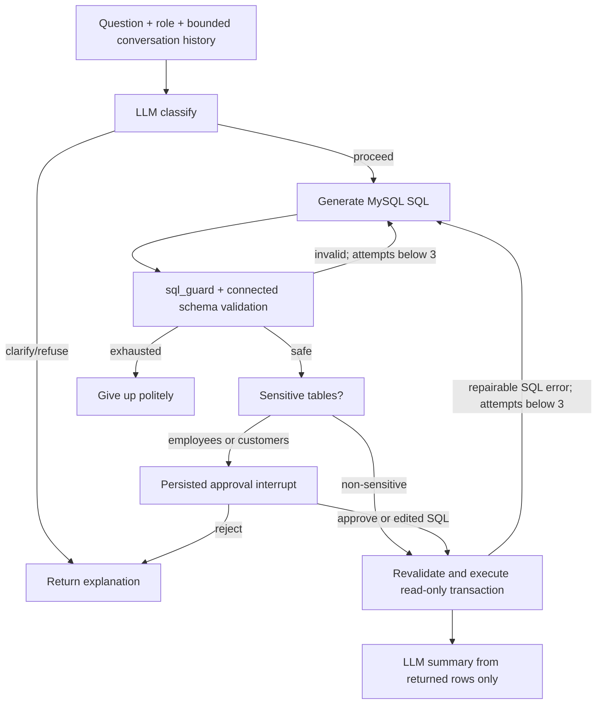

# ColdChain setup and evaluation

This integration is separate from the existing employee SQLite-snapshot demo. Its entry
point is the **coldchain** Streamlit page. No existing Aiven database was modified during
implementation. `main` was not checked out, merged or pushed.

## Create a NEW database on the existing Aiven service

The supplied `golden_eval/schema.sql` contains DROP statements. Do not execute it against
the existing employee database. `golden.json`, `schema.sql` and `seed.sql` are unchanged
copies of the supplied archive (the standalone golden.json is byte-identical).

The safer helper refuses existing database names instead of resetting them:

1. Keep the existing privileged `MYSQL_HOST`, `MYSQL_PORT`, `MYSQL_USER`, `MYSQL_PASSWORD`
   and `MYSQL_DATABASE` settings in local `.env`. Put the Aiven CA certificate at `ca.pem`.
2. Add `COLDCHAIN_READONLY_PASSWORD` to local `.env` with a new password of at least 16
   characters. Do not paste it into chat or command arguments.
3. From the repository root run:

```powershell
.\venv\Scripts\python.exe scripts/setup_coldchain.py --database coldchain_eval --readonly-user coldchain_ro
```

This **creates** a fresh database, loads the immutable fixtures, creates a new SQL user,
grants SELECT on that database only, then writes `COLDCHAIN_DB_URL` and `EVAL_DB_URL` to
the ignored local `.env`. It never overwrites existing database/user identities. An
existing database causes an immediate stop before any DDL. The existing employee
`MYSQL_DATABASE` is explicitly refused as a setup target. No credentials are printed.

MySQL DDL auto-commits. If provisioning fails midway, a partial new database or user may
remain. Inspect that new resource in Aiven/Workbench; the helper will not automatically
delete it. Choose a fresh database/user name or explicitly resolve the partial setup.
If the hosted service denies CREATE DATABASE/USER, use the service's owner/admin account
or create equivalent new resources in Workbench. Do not grant writes to the question user.

The helper is an opt-in provisioning command and was not executed during development.
The original supplied `golden_eval/load_db.py` remains available but is intentionally
not used by the app, CI or evaluation runner.

## Verify fixture compatibility before model evaluation

```powershell
.\venv\Scripts\python.exe golden_eval/run_eval.py --predictor oracle:gold --validator sql_guard:validate
```

This must show 100% answerable and behaviour results against your loaded database. The
supplied gold results were originally checked on MariaDB; this command verifies MySQL
compatibility. No EVAL_DB_URL was configured during implementation, so a live 100% score
is **not** claimed. Static tests do establish that all answerable gold SQL passes the guard.

For real model evaluation:

```powershell
.\venv\Scripts\python.exe golden_eval/run_eval.py --predictor adapter:predict --validator sql_guard:validate --sleep 2 --out coldchain-results.csv
```

The runner works from the repository root. Imports are resolved through the repository
and golden_eval directories, so the exact short module specifications above work. The
adapter imports the real `sql_graph.build_graph`, passes history and role, uses a fresh
in-memory checkpoint/thread per case, and auto-approves only within this evaluation
adapter. Its graph uses prediction-only mode: no query or LLM summary executes inside
the graph; the independent runner executes the validated query once for grading.
Production UI code never imports the autoapproval adapter. Gold answers are not included
in generation prompts or example retrieval. Freeze the dataset/corpus/model/date before
reporting comparisons; do not equate guard acceptance with result correctness.

## Streamlit settings (secret names, never real values)

Keep existing database/certificate/provider settings. Add:

- `COLDCHAIN_DB_URL`: SELECT-only MySQL URL for the new fixture database.
- `EVAL_DB_URL`: same read-only URL for evaluation; optional for the hosted UI if COLDCHAIN_DB_URL exists.
- `PG_URL`: optional PostgreSQL connection string for checkpoint storage, separate from MySQL.
- `LANGSMITH_API_KEY`, `LANGSMITH_TRACING`, `LANGSMITH_PROJECT`.
- `LANGSMITH_HIDE_INPUTS`, `LANGSMITH_HIDE_OUTPUTS`: defaults remain true.
- `GROQ_API_KEY`, `GROQ_LLM_MODEL`, `LLM_PROVIDER`.
- `COLDCHAIN_ADMIN_USERS`: optional comma-separated existing usernames explicitly allowed admin access in this domain.

The app copies only present, allowlisted Streamlit secrets into environment variables
before graph/model imports. Root secrets/environment configuration works locally too.
No ColdChain URL means the new page displays a setup message and makes no database call.
URLs must include verified TLS using the deployed `ca.pem`; preserve `AIVEN_CA_CERT` so
the existing config bootstrap can materialize that certificate on Streamlit Cloud.
Restart/reboot after changing URLs, keys, or checkpoint settings because resources are cached.

Existing public demo accounts default to ColdChain **viewer**, including the IT-admin
account. A new domain does not implicitly grant that account employee salaries/customer
emails. Configure the admin allowlist deliberately. Shared demo accounts are unsuitable
for private organizational data; replace them before connecting anything except fixtures.

## Architecture and role enforcement



`coldchain_graph.py` implements the new MySQL workflow; `sql_graph.py` exports
`build_graph(checkpointer, ...)` and retains the previous employee `SQLWorkflow`.
Sensitive-table approval is applied only to this new path. Existing employee UI approval
behavior is preserved. Each graph call includes `sql-chatbot` tags and model/role metadata.

`sql_guard.validate(sql, role='viewer', limit=100)` replaces the supplied default validator
in both graph and runner. It checks all nested sources/CTEs, blocks writes anywhere in
the AST, SELECT INTO/locking, other schemas, unknown tables/fields, viewer employees,
email/salary columns, customer projection stars, dangerous/session functions and current
clock functions. COUNT(*) is allowed. Unknown roles fail closed. Existing LIMITs are
capped at 100 and UNIONs are wrapped for a global limit. Approved domain table names
come from the immutable fixture schema; connected discovery can narrow, not broaden,
that allowlist. CTE aliases cannot hide a forbidden base table.

`coldchain_context.py` reflects connected names/types, comments, PKs/FKs, ENUM values,
and up to 20 distinct approved categorical values. Higher-cardinality columns omit value
lists instead of dumping records. Viewer metadata excludes employees and sensitive
columns before generation. The attached business glossary is included. The date
`2026-06-30` is **the dataset clock**, not the real wall-clock date. NOW/CURDATE equivalents
are blocked in SQL too.

Execution refreshes schema/policy after an SQL edit, uses the read-only URL, sets a
10-second MySQL statement timeout and a READ ONLY transaction, and fetches at most
101 rows to enforce the 100-row ceiling. Only repairable MySQL codes (1052/1054/1064)
are provided as error feedback; driver messages/credentials are not sent to the LLM.
Provider/infrastructure failures stop rather than retrying indefinitely. No LLM has a
SQL write tool. Row text/product names are untrusted data in the summary prompt. That
prompt reduces injection risk but is not a proof of natural-language faithfulness.

## Persistence and ownership

`checkpointing.get_checkpointer()` is cached by Streamlit. With PG_URL it creates a
`ConnectionPool(max_size=5)` using autocommit/dict rows and calls PostgresSaver.setup().
The PostgreSQL identity needs checkpoint-schema CREATE/read/write privileges; it is
not the MySQL SELECT-only identity. Setup failure stops the page instead of silently
discarding persistent approvals. Without PG_URL, InMemorySaver is used with a visible
restart/sleep warning.

The URL stores a UUID `tid`. On each page load the app checks graph.get_state() and
restores pending interrupts into an editable SQL review box. Approve/reject resumes
via Command. The actual checkpoint thread key is namespaced by authenticated username
AND role, so another user copying the URL cannot read the original identity's state.
Auth already exists: an insecure “TODO add authorization later” was not copied. The
remaining TODO is replacing intentionally shared demo identities for production.

Checkpoints contain conversation, SQL and result rows. Secure PostgreSQL access, TLS,
retention and backups accordingly. PG restart recovery was tested through mocked pool
setup and graph reconstruction with a shared in-memory saver; a real PG restart test
requires a configured database and was not performed here.

## Tests, CI and dependencies

Run `python -m pytest -q` without API/database credentials. Tracing is disabled in tests.
New tests cover role/CTE/schema guards, all answerable gold statements, comments/value
context, private metadata exclusion, classification routing, history, retries, selective
approval, reconstruction/resume, edited SQL, evaluation-only no-execution mode, row
injection prompt boundaries, owner/role namespace isolation and pool cleanup.

CI targets dev pull requests and dev/feature pushes with Python 3.11. Existing dependency
pins are retained with one compatibility qualification: NumPy 2.5.2 remains pinned for
Python 3.12+, and NumPy 2.4.6 is selected on 3.11 because 2.5.2 requires a newer Python.
Python 3.11 dependency resolution was checked locally; actual tests ran on Python 3.12.
GitHub's Linux job is the final 3.11 runtime check.

New exact pins: langgraph-checkpoint-postgres 3.1.0, psycopg[binary,pool] 3.3.9,
psycopg-binary 3.3.9, psycopg-pool 3.3.3. Existing langgraph/checkpoint/langsmith/Groq,
SQLAlchemy/PyMySQL/cryptography/SQLGlot pins remain. The latest checkpoint-postgres
required upgrading an existing pin, so a compatible release was selected instead.

## Known limitations

- No ColdChain source or PG URL was available locally: no live oracle percentage or real
  PostgreSQL restart durability result is claimed.
- Schema/glossary grounding does not prove semantic correctness. The supplied independent
  result comparison is needed, including fanout, date, NULL and business-definition traps.
- The fixed evaluation date must be changed deliberately for a future production dataset.
- LangSmith input/output hiding does not remove all error/metadata information; keep
  tracing restricted to approved demo data and review retention settings.
- The existing employee evaluation remains a separate 56-case dataset and is not a
  substitute for the ColdChain oracle check.
- Source provisioning is explicitly opt-in. No DROP/GRANT/provisioning command ran during
  implementation, and setup failures may leave partial *new* resources.
