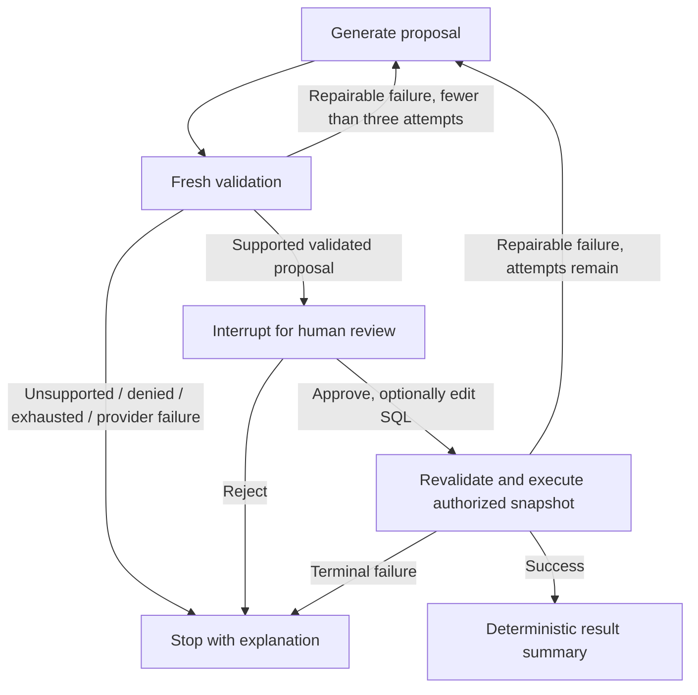

# LangSmith first, LangGraph second

Implemented on `feature/langgraph-langsmith`, based on the existing Groq/schema-intelligence
work rather than the older `dev` branch. The current working provider changes are preserved.
The deployed main branch is not modified by these local changes.

## 1. Observe the existing workflow first

The classic workflow is still the default (`SQL_WORKFLOW=classic`). `observability.py`
loads only explicitly allowlisted provider/tracing settings from Streamlit Secrets into
environment variables. `config.py` calls this after loading local `.env`, before the
application imports its model and orchestration modules. Missing local Secrets is normal.

LangSmith tracing defaults to false. Input and output hiding default to true. Custom
trace decorators additionally replace their input/output payloads with empty dictionaries.
No new code prints or commits API-key values. `.streamlit/secrets.toml` is now gitignored.
Use the committed `.streamlit/secrets.example.toml` as the settings template.

Local `.env` example:

```dotenv
LLM_PROVIDER=groq
GROQ_API_KEY=your_existing_key
LANGSMITH_API_KEY=your_langsmith_key
LANGSMITH_TRACING=true
LANGSMITH_PROJECT=sql-chatbot
LANGSMITH_HIDE_INPUTS=true
LANGSMITH_HIDE_OUTPUTS=true
SQL_WORKFLOW=classic
```

For `.streamlit/secrets.toml` or Streamlit Cloud Secrets, use TOML strings instead:

```toml
LANGSMITH_API_KEY = "your_langsmith_key"
LANGSMITH_TRACING = "true"
LANGSMITH_PROJECT = "sql-chatbot"
LANGSMITH_HIDE_INPUTS = "true"
LANGSMITH_HIDE_OUTPUTS = "true"
SQL_WORKFLOW = "classic"
```

Preserve existing database, certificate and Groq settings. Restart Streamlit after editing
settings. Set tracing to true only with an appropriate LangSmith account/key and approved
demo data. Project/run metadata, timing, token usage and error information can still be sent
even when inputs/outputs are hidden. These settings do not promise universal PII redaction
of third-party exception text. Full payload tracing is not enabled by this implementation.
Review retention/access controls before connecting private organizational data.

The classic pipeline now has named spans for retrieval, proposal creation, model generation,
fresh validation and snapshot execution. LangChain supplies nested model spans when tracing
is enabled. No key was available during implementation, so no cloud trace, pricing quota,
or before/after model-accuracy figure is claimed. No account/API key was created automatically.

Already installed/pinned compatible versions were retained: `langgraph==1.2.11`,
`langsmith==0.12.1`, `langchain-groq==1.1.3` and `sqlglot==30.18.0`. An unbounded upgrade
was unnecessary for the APIs used here.

## 2. Opt into the graph

Enable **Use controlled LangGraph workflow** in the sidebar, or set `SQL_WORKFLOW=graph`
to start with it enabled. Classic behavior remains available for comparison.



`sql_graph.SQLWorkflow` compiles a `StateGraph(QueryState)` with generate, validate,
review, execute and summarize nodes. Existing `prepare_proposal()` already applies
semantic validation; the explicit graph validation node checks it again against fresh context.
`validate_proposal()` was extracted from `execute_proposal()` for this purpose. Both
classic and graph execution retain the same SQLite dialect, RBAC projection and safeguards.

All queries require approval, preserving the existing app behavior. The attachment's
sensitive-table-only shortcut and direct MySQL execution were deliberately not copied.
Review edits change only the proposal SQL; owner, original question and context versions
are preserved and checked before execution. A repaired proposal always pauses for a new
approval. Previous approval is never carried across a new model-generated query.

Generation attempts are bounded to three per question. Schema/safety/semantic errors and
SQLite operational failures can enter the repair path. Provider, permission and unrelated
infrastructure errors stop rather than repeatedly spending API calls. Feedback is a fixed
validation hint, not raw exception text, SQL parameters or result rows. Retrieval/intent uses
the original question even during repair. A question can now incur up to three generation
calls; session question count is not a global request-rate limiter.

The summary reports returned row count within the authorized scope. It does not make a
second LLM request or transmit result rows to a summarization model.

## 3. State lifecycle and isolation

Each Streamlit session owns its workflow object. It is never stored in a shared resource
cache. The user/engine are closure dependencies, not serialized graph state. Each new
question creates a fresh UUID thread ID and in-memory checkpointer, discarding old state.
`resume()` requires the same server-owned identity and a pending interrupt. Repeating an
approval after completion fails. Logout already clears the whole session state.

The checkpointer is `InMemorySaver`: restarting/sleeping the app loses pending reviews.
This is intentional for the demo. A durable checkpointer requires a separate decision about
storage, encryption, retention and identity binding; no new database was introduced here.
Do not enable Streamlit's enforceSerializableSessionState for this in-memory object without
adapting the storage design. A long-running paused browser session holds its current state
until a new question, logout or process restart.

## 4. Files and validation

New files: `observability.py`, `sql_graph.py`, `.streamlit/secrets.example.toml`,
`tests/test_observability.py`, `tests/test_sql_graph.py`, and this guide.
Changed files: config bootstrap, pipeline validation/tracing/repair feedback, model tracing,
Streamlit controls, secrets ignore rules, environment example and UI regression tests.

Stage-one tracing changes passed the existing 171 tests before the graph was introduced.
Graph tests cover pause/reject without execution, approve once, owner/session isolation,
three-attempt limits, reapproval after repair, edited SQL rejection, actual local snapshot
execution and no retries for unsupported/provider failures. A Streamlit AppTest covers the
graph selection, generation, review gate and execution button.

```powershell
.\venv\Scripts\python.exe -m pytest tests -q
.\venv\Scripts\python.exe scripts/evaluate.py --mode D --split all
.\venv\Scripts\python.exe -m streamlit run sqlapp.py
```

The existing 56-case offline runner still measures classic context configurations A/B/C/D.
It is not a graph-versus-classic live accuracy benchmark. To compare workflow strategies,
freeze the same held-out cases, provider/model/date, corpus, scope and decoding settings;
run the classic baseline first, then the graph, recording all attempts, usage, rejections,
latency and result correctness. Do not count repair attempts as independent test questions
or include held-out SQL in retrieval. Human approval must remain explicit in live UI runs.

## 5. Completion boundary

The code integration and offline tests can be verified without a LangSmith key. Live cloud
traces, hosted Streamlit Secrets changes and a paid/rate-limited live golden-set comparison
require valid account settings and are not represented as completed by local tests.
