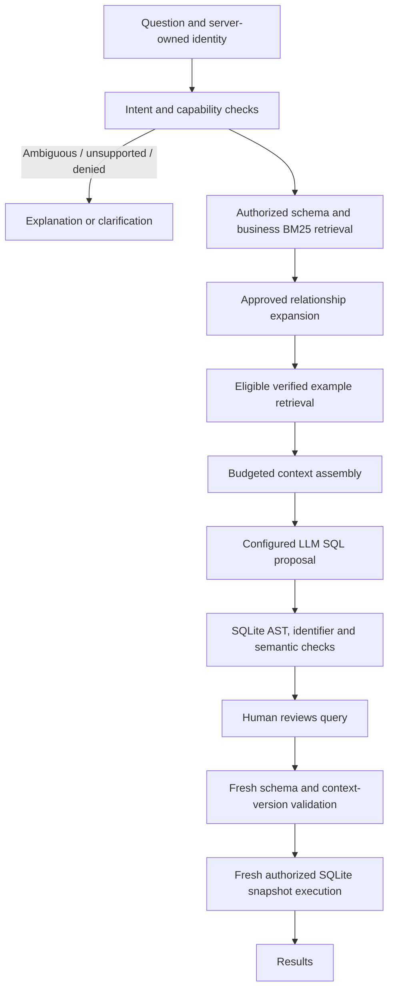

# Schema intelligence, retrieval and semantic validation

The live path remains **MySQL → authorized rows/columns → private SQLite snapshot**.
The configured LLM proposes SQL; the user must still click **Run this query**. No generated SQL is
executed on MySQL. Existing login, explorer and confirmed job-title edits are preserved.

## Run and test

Use Python 3.12:

```powershell
.\venv\Scripts\python.exe -m pip install -r requirements-dev.txt
.\venv\Scripts\python.exe -m streamlit run sqlapp.py
```

```powershell
.\venv\Scripts\python.exe -m pytest tests -q
.\venv\Scripts\python.exe scripts/evaluate.py --mode D --split all
```

The retrieval dependency is `rank-bm25==0.2.2`. Groq support adds `langchain-groq==1.1.3`
and `groq==0.37.1`. Set `LLM_PROVIDER=groq`, `GROQ_API_KEY` and `GROQ_LLM_MODEL` in
the local ignored `.env` file; see the README for setup. Gemini remains an optional fallback.
PyYAML, SQLAlchemy,
SQLGlot, PyMySQL and the Gemini adapter were already present. A separate dev requirement
pins pytest. No vector database, additional server, model provider or live table is needed.

## Request path



## Modules and boundaries

| Module | Responsibility |
|---|---|
| `context_models.py` | Immutable metadata, business rules, intent and context records |
| `schema_context.py` | SQLAlchemy reflection of allowlisted sources, SQLite logical projection, fingerprints |
| `business_context.py` | Reviewed YAML loading, permission filtering, bounded intent analysis |
| `retrieval.py` | Tokenization, cached BM25Plus ranking, approved graph paths |
| `sql_examples.py` | Evidence/version/permission eligibility and explicit maintainer approval |
| `context_pipeline.py` | Context assembly, proposal generation and execution revalidation |
| `safety.py` | One SQLite query, no nested writes/output/locks, identifier qualification |
| `semantic_validation.py` | Supported metric, population/filter, grouping, ranking and join checks |
| `sql_generator.py` | Single configured-provider call and typed response parsing; no execution |
| `database.py` | Existing authorization and snapshot boundary; bounded source read |

### Physical and logical schema

Reflection reads column names, types, nullability, primary keys, unique constraints,
foreign keys and supported comments. Physical metadata is cached for five minutes;
execution approval bypasses that cache. Source credential material is not emitted.

The approved production mapping exposes **only** `RBAC_DEMO_EMPLOYEES` as logical
`EMPLOYEES`. The original physical `EMPLOYEES` and audit table remain unavailable to
generated SQL. Discovering a physical table does not grant access. The mapping checks
required columns, SQLite type affinities and the employee identity key; incompatible
changes stop generation/execution rather than guessing a mapping.

HR gets salary fields and definitions. Employee users get Engineering rows and no
salary fields. IT admin gets all departments without salary. Every row snapshot is
fresh; results are not cached. Source reads use `LIMIT 10001` and reject more than
10,000 authorized employees. The original 500-result-row and SQLite execution limits
remain in place, and the employee primary key is preserved inside the snapshot.

### Business definitions

`metadata/business_rules.yaml` is the reviewed, versioned source of semantic knowledge,
separate from reflected metadata. Only approved rules are eligible. Permission checks
happen before their text is indexed or supplied to Gemini.

Included definitions distinguish employee count, recorded salary sum/average/extrema,
department, job title, manager labels and explicitly requested manager exclusions.
Currency and salary period remain unspecified. No revenue or active-employment metric
is invented. Increment a rule's version when its semantics change; update affected
examples through review. Changed content also invalidates pending proposals.

The two manager-exclusion rules apply **only when the question requests them**. `CEO`
is a recorded placeholder in the fictional demo, not a universally inferred job role.
Manager names are labels, not unique identity keys.

### BM25 and relationships

Schema and rule documents use independent BM25 channels. Underscored identifiers are
preserved and split into component tokens. Approved aliases accompany definitions;
negation is not removed. No-overlap queries return no arbitrary top-k examples.

BM25 scores are ranking signals, not probabilities. BM25Plus is used with an explicit
lexical-overlap gate because its smoothing baseline can be positive without overlap.
Indexes are bounded in-process caches keyed by immutable, already-authorized documents.

Small schemas remain complete in context. A larger schema can be pruned, then expanded
through unique approved paths of at most two hops, retaining bridge tables and composite
key columns. Hidden endpoints/keys and unapproved edges cannot be expanded. Ambiguous
or disconnected paths fail explicitly.

**The current exposed catalog has no foreign keys**, so its relationship graph is empty.
Positive bridge/composite-key/fanout behavior is tested on synthetic local fixtures;
new production mappings/relationships require deliberate authorization and review.

The context character ceiling is 18,000. Optional examples are dropped first, followed
by optional definitions. Required contracts and schema are never silently truncated.
The displayed token estimate is characters/4, not provider token accounting. Actual
usage is recorded separately when the provider returns it.

### Verified SQL demonstrations

`metadata/sql_examples.jsonl` contains three implementation-reviewed examples: visible
count, departmental count and departmental average. Their fixture answers are derived
independently and checked by `test_bundled_examples_are_reviewed_against_expected_results`.
Only question/SQL demonstrations, not expected result rows, enter prompts.

Eligibility requires:

- Approved status, named reviewer, review date and semantic/expected-result evidence.
- Matching SQLite dialect and logical dependency fingerprint.
- Current referenced business-rule versions.
- Required permissions and available fields.
- Actual SQL dependencies consistent with declared metadata.
- SQL and semantic revalidation against the current catalog.

Unknown, draft, retired, stale, incompatible or malformed records are excluded. Successful
queries and feedback are never automatically written to the collection or promoted.
Public demo admin credentials do not authorize example approval.

To add an example:

1. Add a new `draft` record with question, SQL, dialect, referenced tables/columns and
   a template family. Do not put it in the held-out evaluation set.
2. Review the metric, filters, units, join cardinality and NULL/duplicate behavior.
3. Independently calculate expected rows for the fictional fixture and save a JSON array.
4. Run the explicit local review command:

```powershell
.\venv\Scripts\python.exe scripts/review_example.py `
  --approve your-draft-id `
  --reviewer your-name `
  --review-note "Reviewed employee grain, required filters and independently calculated fixture totals." `
  --expected-results expected-rows.json
```

The command validates and compares results in a disposable SQLite fixture, then records
the explicit review. The review note represents the maintainer's semantic judgment;
matching fixture results alone cannot establish correctness on every possible dataset.
Review the resulting file diff and add meaningful edge-case tests before committing.

### Semantic validation: guarantees and limits

Supported deterministic checks cover:

- Read-only SQLite AST descendants, not just the root statement type.
- Authorized base tables/columns, aliases and CTE scopes; file/extension functions denied.
- Explicit complete approved join keys; name joins and unapproved Cartesian joins rejected.
- Conservative fanout detection for aggregates on a relationship's duplicated side.
- Recognized SUM/AVG/MIN/MAX/COUNT definitions appearing in actual projected outputs.
- Direct CTE output lineage, so unused correct SQL cannot validate a wrong outer result.
- Requested grouping dimensions and explicit employee output fields.
- Recognized department/name/salary filters and requested manager exclusions.
- Required conjuncts rather than predicates weakened by `OR 1=1`.
- Recognized employee-count HAVING thresholds, top/bottom limits and ranking fields.
- Fresh owner, policy, schema and reviewed-context checks at execution time.

This is **bounded contract validation**, not a proof that arbitrary English and SQL are
equivalent. Intent analysis uses explicit reviewed phrases and patterns. Some equivalent
SQL forms are conservatively rejected, and unrecognized conditions/extra output logic
still need review. Complex metric arithmetic, arbitrary derived-table joins and
many-to-many analytics need an approved analytical contract/view before support expands.
Model confidence is displayed as self-reported confidence, not semantic verification.

## Evaluation

`evaluation/questions.jsonl` has 56 reviewed cases across eight categories, with 51
held-out cases and five development cases. Query cases include explicit independently
calculated expected rows. Unsupported date/multi-table questions are negative cases for
the actual schema; positive relational behavior belongs to synthetic tests.

Modes:

| Mode | Prompt context |
|---|---|
| A | Full authorized schema, without business definitions/examples |
| B | Full authorized schema plus reviewed business definitions |
| C | B with BM25 context selection and relationship expansion |
| D | C plus eligible verified demonstrations |

All modes use the same new safety/capability checks so generation-context differences
can be compared under a common execution policy. A is a schema-only ablation, **not a
bit-for-bit replay of the pre-upgrade application**.

```powershell
.\venv\Scripts\python.exe scripts/evaluate.py --mode D --split heldout --output report.json
```

The default is offline: it checks intent, contracts and reference SQL against fixtures.
It does not call Gemini or measure LLM accuracy. A real model evaluation must be explicitly
enabled:

```powershell
.\venv\Scripts\python.exe scripts/evaluate.py --mode D --split heldout --live-llm --output live-report.json
```

This makes real provider requests and may incur charges, but SQL still executes only on
the disposable fictional fixture. Optional `--input-price-per-million` and
`--output-price-per-million` values calculate an estimate from returned usage; unknown
usage/cost stays null. No benchmark improvement is claimed without these runs.

Reports include expected-action/result correctness, execution success, table/rule context
recall, context size estimates, per-case/percentile latency and available actual usage/cost.
Ordering and duplicate rows are preserved where relevant; numeric comparison has a stated
tolerance. No question or query is automatically saved during evaluation.

Demonstration families and paraphrases are assigned to development. Held-out family,
exact-question and normalized-SQL overlaps are rejected before evaluation. Maintainers
must also review near duplicates and group newly added paraphrases consistently; these
checks cannot automatically establish semantic independence.

## Operating and extending safely

- Metadata/index caches are rebuildable; reviewed YAML/JSONL is the durable source.
- Refresh incompatibilities fail closed; no unrestricted schema fallback exists.
- Regenerate stale proposals after any reviewed context or policy change.
- New physical tables require an explicit logical projection and snapshot authorization
  changes; retrieval cannot grant access on its own.
- No application code promotes examples or adds arbitrary SQL write tools.
- GitHub Actions runs unit/UI tests and offline fixture checks without live credentials.
- Provider access/quota failures are reported separately from SQL validation failures;
  provider response bodies and credential material are not shown in the UI.
